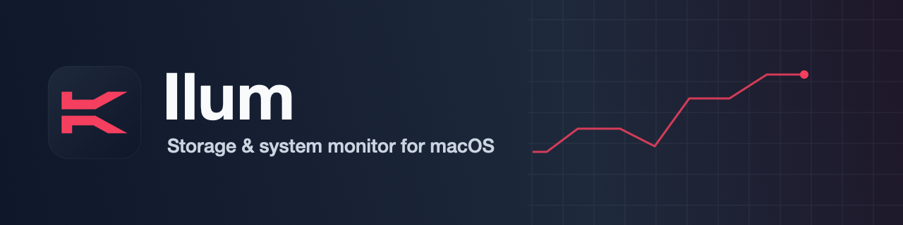

Ilum is a macOS menu bar app for finding what takes up space, reviewing cleanup candidates, and monitoring CPU and memory. The app is available in **English and German** via the **DE / EN** switch in the toolbar and menu bar popover.

## Download

**macOS 13.3 or later · Apple Silicon and Intel.** The public DMG is pending. Published builds will be available through GitHub Releases and the [DFT IT website](https://dft-it.com/). [Release setup and updates](RELEASE.md)

## Features

- **Storage history** compares measurements and shows where usage grew.
- **Cleanup** previews old caches, logs, large files, and duplicates before you move eligible files to the Trash.
- **Developer tools** finds dependency folders, build artifacts, package caches, and Docker storage.
- **System monitor** tracks CPU, memory, disk usage, and active processes from the menu bar.

## Build locally

Requires Node.js 22+, stable Rust, and the Xcode Command Line Tools.

```sh
npm ci
npm run tauri dev
```

Use `npm run tauri build -- --bundles app` for a local app bundle. [Architecture and code conventions](docs/development.md)

## Privacy and permissions

Scans and storage history run locally. Ilum skips paths blocked by macOS. **Settings → File Access** checks Desktop, Documents, and Downloads. Scans also cover other readable locations. Full Disk Access is optional. [Scan coverage](docs/development.md#scan-coverage)

## License

Ilum’s source code is licensed under the [MIT License](LICENSE). The icon uses a glyph from [FT Aurebesh Bold by Rodrigo Fuenzalida](https://www.behance.net/gallery/169610961/FT-Aurebesh), distributed under the [SIL Open Font License](src-tauri/icons/FT-Aurebesh-OFL.txt).
