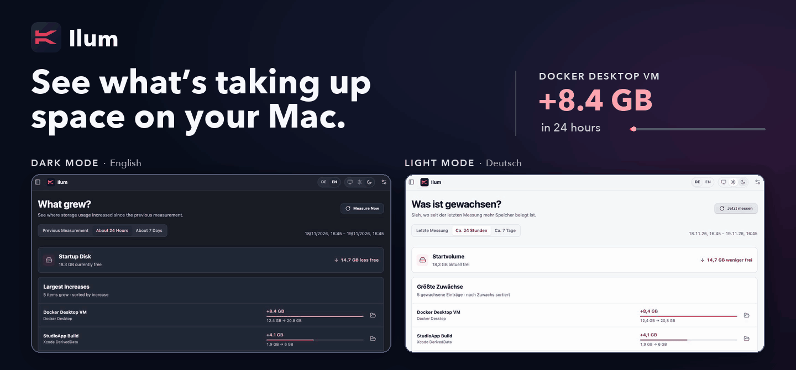
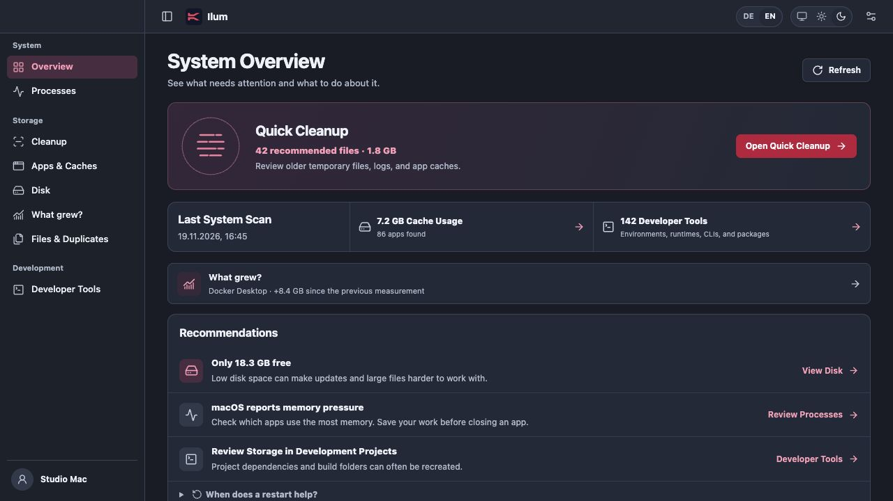

<p align="center">
  <a href="https://github.com/DFT-IT/ilum/releases/latest/download/Ilum.dmg"></a>
  <br>
  <strong>macOS 13.3 or later · Apple Silicon and Intel</strong>
</p>

Open the DMG and drag Ilum into **Applications**. Check for newer versions under **Settings → Software Update**. The download is ad-hoc signed, so macOS may block the first launch. [Release notes](https://github.com/DFT-IT/ilum/releases/latest)

## What you can do

- **Storage history** shows what grew between measurements.
- **Cleanup** helps you review old caches, logs, large files, and duplicates before moving eligible items to the Trash.
- **Developer tools** find dependency folders, build artifacts, package caches, and Docker storage.
- **System monitoring** shows CPU, memory, disk usage, and active processes.

## A closer look

[](docs/screenshots/system-overview.jpg)

Switch the language with **DE / EN** and the appearance with **Light** or **Dark** in the toolbar. Screenshots use sample data. [Dark mode · English](docs/screenshots/storage-history-dark-en.jpg) · [Light mode · Deutsch](docs/screenshots/storage-history-light-de.jpg)

## Build locally

[](https://tauri.app/)
[](https://www.rust-lang.org/)
[](https://react.dev/)
[](https://www.typescriptlang.org/)
[](https://tailwindcss.com/)

Requires Node.js 22+, stable Rust, and the Xcode Command Line Tools.

```sh
npm ci
npm run tauri dev
```

For a local app bundle, run `npm run tauri build -- --bundles app`. [Development guide](docs/development.md) · [Release guide](RELEASE.md)

## Privacy and permissions

Scans and storage history stay on your Mac. Ilum skips paths blocked by macOS. Check access under **Settings → File Access**. Full Disk Access is optional. [Scan coverage](docs/development.md#scan-coverage)

## License

Ilum’s source code is licensed under the [MIT License](LICENSE). The icon uses a glyph from [FT Aurebesh Bold by Rodrigo Fuenzalida](https://www.behance.net/gallery/169610961/FT-Aurebesh), distributed under the [SIL Open Font License](src-tauri/icons/FT-Aurebesh-OFL.txt).
